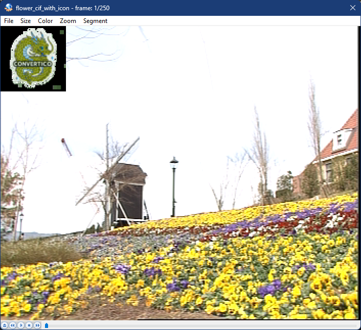

# y4m + BMP

Консольная утилита на C++ для добавления BMP-изображения в y4m-видео. На выходе получается новый y4m-файл с вставленной картинкой.

## Запуск

```bash
AddingRGBImageToYUV420Video.exe
```

## Использование

Программа запрашивает три значения в консоли:

| Параметр | Описание |
|----------|----------|
| Путь к y4m | Исходное видео в формате YUV4MPEG2 |
| Путь к BMP | Изображение, которое нужно добавить в видео |
| Путь для сохранения | Куда записать итоговое y4m-видео |

Если на любом из запросов просто нажать **Enter**, будет использован пример по умолчанию из репозитория (тестовое y4m-видео и BMP-картинка).

## Результат

Первый кадр видео `flower_cif` с добавленной картинкой в левом верхнем углу:



## Требования

- C++11
- clang++
